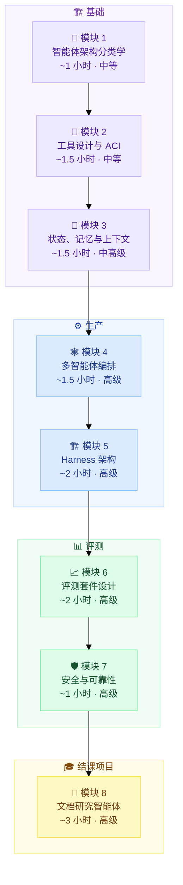

<div align="center">

# 🤖 Agent Harness 与评测
### 面向工程师的生产级 AI 课程

[](https://rajeevraibhatia.com/ai-courses/agent-harness-evals)
[](https://github.com/rajeevraibhatia/agent-harness-evals/stargazers)
[](LICENSE)

**从 ReAct 循环到生产级评测框架。** 8 个模块，中等 → 高级，含面试准备。

*属于 [AI Courses](https://rajeevraibhatia.com/ai-courses) 系列，作者 [Rajeev Rai Bhatia](https://rajeevraibhatia.com)*

[English](README.md) | **简体中文**

</div>

---

## 🗺️ 学习路线



---

## 📚 模块

所有 notebook 均使用 **OpenAI SDK**（`gpt-4o`），可在 Google Colab 中独立运行，无需本地配置。

| # | 模块 | 核心概念 | 时长 | 难度 | 阅读 | Notebook |
|---|------|---------|------|------|------|----------|
| 1 | **智能体架构分类学** | 工作流 vs 智能体、6 大构件、ReAct vs 先规划后执行、ACI | ~1 小时 | 🟡 中等 | [→ 阅读](https://rajeevraibhatia.com/ai-courses/agent-harness-evals#module-1) | [](https://colab.research.google.com/github/rajeevraibhatia/agent-harness-evals/blob/main/notebooks/m1_react_loop.ipynb) |
| 2 | **工具设计与 ACI** | JSON Schema 设计、幂等性、函数调用、MCP、工具注册表 | ~1.5 小时 | 🟡 中等 | [→ 阅读](https://rajeevraibhatia.com/ai-courses/agent-harness-evals#module-2) | [](https://colab.research.google.com/github/rajeevraibhatia/agent-harness-evals/blob/main/notebooks/m2_tool_registry.ipynb) |
| 3 | **状态、记忆与上下文工程** | 三层记忆、上下文腐化、MemoryManager、会话交接 | ~1.5 小时 | 🟠 中高级 | [→ 阅读](https://rajeevraibhatia.com/ai-courses/agent-harness-evals#module-3) | [](https://colab.research.google.com/github/rajeevraibhatia/agent-harness-evals/blob/main/notebooks/m3_memory_manager.ipynb) |
| 4 | **多智能体编排模式** | 监督者、辩论、蜂群、生产者-评审者、死锁检测 | ~1.5 小时 | 🔴 高级 | [→ 阅读](https://rajeevraibhatia.com/ai-courses/agent-harness-evals#module-4) | [](https://colab.research.google.com/github/rajeevraibhatia/agent-harness-evals/blob/main/notebooks/m4_multi_agent.ipynb) |
| 5 | **Harness 架构** | 初始化器/执行器模式、以 git 作为记忆、回放日志、熔断器 | ~2 小时 | 🔴 高级 | [→ 阅读](https://rajeevraibhatia.com/ai-courses/agent-harness-evals#module-5) | [](https://colab.research.google.com/github/rajeevraibhatia/agent-harness-evals/blob/main/notebooks/m5_harness.ipynb) |
| 6 | **评测套件设计** | pass@k vs pass^k、3 类评分器、LLM-as-judge 校准、SWE-Bench | ~2 小时 | 🔴 高级 | [→ 阅读](https://rajeevraibhatia.com/ai-courses/agent-harness-evals#module-6) | [](https://colab.research.google.com/github/rajeevraibhatia/agent-harness-evals/blob/main/notebooks/m6_eval_suite.ipynb) |
| 7 | **安全、失效模式与可靠性** | 提示注入、过度自主、6 类失效分类、基于轨迹的强化学习 | ~1 小时 | 🔴 高级 | [→ 阅读](https://rajeevraibhatia.com/ai-courses/agent-harness-evals#module-7) | [](https://colab.research.google.com/github/rajeevraibhatia/agent-harness-evals/blob/main/notebooks/m7_safety.ipynb) |
| 8 | **结课项目：文档研究智能体** | 端到端实现 —— ToolRegistry、MemoryManager、Harness、评测套件 | ~3 小时 | 🔴 高级 | [→ 阅读](https://rajeevraibhatia.com/ai-courses/agent-harness-evals#module-8) | [](https://colab.research.google.com/github/rajeevraibhatia/agent-harness-evals/blob/main/notebooks/m8_capstone.ipynb) |

---

## 🚀 快速开始

```bash
pip install openai numpy
export OPENAI_API_KEY="sk-..."
```

或者直接在 Colab 中打开任意 notebook —— 无需本地配置，每个 notebook 都会自行安装依赖。

---

## 🏗️ 你将构建什么

到模块 8 结束时，你会得到一个可运行的 **文档研究智能体**：

```
agent-harness-evals/
├── tool_registry.py      # Schema 校验、幂等性闸门、错误包装
├── memory_manager.py     # 上下文内 + 情景 + 语义 三层记忆
├── harness.py            # 初始化器/执行器、回放日志、熔断器
├── eval_suite.py         # 10 个任务的评测套件、代码 + LLM 评分器、pass@k 打分
└── notebooks/            # 每个模块一个 Colab notebook
```

**进阶目标：** 让你的 harness 跑 [GAIA Level 1](https://huggingface.co/datasets/gaia-benchmark/GAIA) 任务，并与公开榜单对比。

---

## 🎯 面试准备

每个模块末尾都有一个资深级别的系统设计题。例如：

> *"工作流和智能体有什么区别？针对一个客服产品，各举一个例子。"*

> *"你的智能体在生产环境跑到第 20 轮后开始出现性能退化。请说明你的诊断思路和架构层面的修复方案。"*

> *"你的编码智能体能通过 95% 的评测套件。你如何判断这套评测衡量的确实是正确的东西？"*

---

## 📄 研究参考文献

| 论文 | 作者 | 年份 | 模块 |
|------|------|------|------|
| [ReAct: Synergizing Reasoning and Acting](https://arxiv.org/abs/2210.03629) | Yao 等 | 2022 | M1 |
| [Tree of Thoughts](https://arxiv.org/abs/2305.10601) | Yao 等 | 2023 | M1 |
| [CodeAct](https://arxiv.org/abs/2402.01030) | Wang 等 | 2024 | M2 |
| [MemGPT](https://arxiv.org/abs/2310.08560) | Packer 等 | 2023 | M3 |
| [Generative Agents](https://arxiv.org/abs/2304.03442) | Park 等 | 2023 | M3 |
| [Multi-Agent Debate](https://arxiv.org/abs/2305.14325) | Du 等 | 2023 | M4 |
| [Indirect Prompt Injection](https://arxiv.org/abs/2302.12173) | Greshake 等 | 2023 | M7 |
| [Let's Verify Step by Step](https://arxiv.org/abs/2305.20050) | Lightman 等 | 2023 | M7 |

---

## 🤝 参与贡献

Notebook 正按模块逐个补充。点星关注仓库进展。欢迎提交 PR：

- Notebook 改进
- 补充练习题
- 修复示例代码中的 bug

---

<div align="center">

由 [Rajeev Rai Bhatia](https://rajeevraibhatia.com) 构建 · [AI Courses](https://rajeevraibhatia.com/ai-courses) · [LinkedIn](https://www.linkedin.com/in/rajeevraibhatia/)

⭐ **给本仓库点星**，帮助更多工程师发现它

</div>
